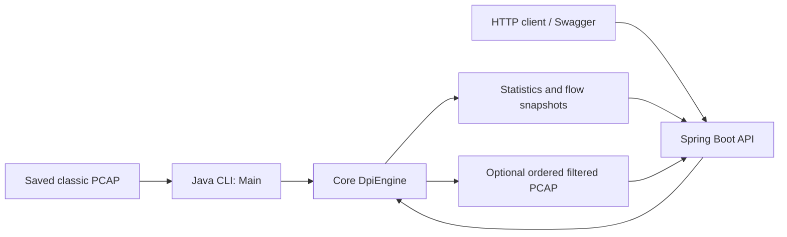

# Java 21 Deep Packet Inspection Engine

An offline classic-PCAP analyzer and filter with a Java CLI and a Spring Boot REST API. It reads saved captures, tracks directional TCP/UDP flows, extracts visible hostnames, classifies applications using explicit domain mappings, and writes allowed records to a new PCAP.

## Purpose

Packet headers alone do not explain which application generated traffic. This learning and resume project connects binary parsing, protocol inspection, stateful rule evaluation, concurrent Java processing, REST design, and container deployment. It provides concrete examples to discuss in backend interviews: preserving ordering across workers, bounding resource use, and cleaning up files when requests fail.

The Java engine and REST API support offline inspection and filtering. ML/AI integration is not implemented.

## Implemented features and stack

- Classic PCAP 2.4 reading/writing in either byte order, with microsecond or nanosecond timestamps.
- Ethernet II, unfragmented IPv4, TCP and UDP parsing; directional five-tuple flow statistics.
- HTTP/1 Host, cleartext TLS ClientHello SNI, and DNS query-name extraction.
- Explicit domain-to-application mappings and port-based HTTP/HTTPS/DNS fallbacks.
- Application, domain/subdomain and exact IPv4 blocking; retained block decisions per directional flow.
- Sequential processing or 2–64 flow-affine workers with bounded pending work and ordered output.
- REST analysis and PCAP download, strict options validation, resource budgets and request-owned temporary files.
- Swagger/OpenAPI, health endpoint, multi-stage Docker build and local Compose deployment.

Java 21; Maven multi-module build; Spring Boot 3.5.16; springdoc-openapi 2.9.1; JUnit Jupiter 5.13.4 in the core and Spring Boot test support in the API. Core runtime code uses the Java standard library and has no Spring dependency. Versions come from the checked-in POMs.

## Scope and limitations

This is an offline analyzer/filter, not a live firewall, HTTPS decryptor or ML classifier. Inspection is packet-local: no TCP reassembly, IP fragment reassembly, IPv6, VLAN parsing, HTTP/2, QUIC inspection, or checksum verification. TLS/QUIC enum names are reserved and are not emitted by the classifier. SNI must be visible in a complete ClientHello; encrypted or split handshakes cannot supply a hostname. Domain mappings are heuristics, not proof of application identity.

Unsupported or malformed **network packets** inside valid captures are counted as skipped and allowed unchanged, even with blocking rules. Invalid **PCAP framing** fails processing. The API rejects non-Ethernet link types with 400; the standalone core/CLI instead skips and allows their records. Reverse traffic has its own flow and classification. Blocking starts when a rule matches and does not remove earlier allowed packets. There is no authentication or transport TLS; defaults target local use.

## Architecture



Details: [architecture](docs/ARCHITECTURE.md), [data flows](docs/DATA_FLOW.md), [request sequences](docs/SEQUENCE.md), [API contract](docs/API.md), and [technical internals](docs/TECHNICAL.md).

## Repository structure

```text
Packet_analyzer/
  pom.xml                         Maven reactor: the two Java modules
  dpi-engine-java/
    pom.xml
    src/main/java/com/dpiengine/
      Main.java                   CLI adapter
      pcap/ packet/ inspect/      Capture I/O, parsing, classification
      flow/ rules/ engine/ report/
    src/test/java/com/dpiengine/
  dpi-engine-api/
    pom.xml
    README.md
    VERIFICATION.md
    src/main/java/com/dpiengine/api/
    src/main/resources/application.properties
    src/test/java/com/dpiengine/api/
  docs/                           Architecture, API and fixture documentation
  Dockerfile
  compose.yaml
  .dockerignore
  docker-verify.ps1
  DOCKER.md
  test_dpi.pcap                    Demo capture
  generate_test_pcap.py            Deterministic synthetic fixture generator
  PROVENANCE.md                   Reference attribution and permission status
  .gitignore                      Build outputs and private/local files
```

See [PROVENANCE.md](PROVENANCE.md) for reference attribution and permission status. Generated captures, build targets and local logs are omitted from this overview.

## Prerequisites and build

For a host build, install JDK 21 and Maven, with `java` and `mvn` on PATH and `JAVA_HOME` pointing at the JDK. The first dependency download needs internet access. Examples use Windows PowerShell and Windows `curl.exe`. For the container route, use Docker Desktop with Linux containers and Compose; host Java/Maven are unnecessary.

Run from the repository root:

```powershell
Set-Location D:\Projects\Packet_analyzer
java -version
mvn -version
mvn clean verify
if ($LASTEXITCODE -ne 0) { throw 'Build failed' }
```

The reactor tests and packages both modules, including the executable API JAR. To test without packaging: `mvn test`. The root is an aggregator; the API uses the Spring Boot parent independently.

## CLI

After building, from the root:

```powershell
java -cp dpi-engine-java/target/classes com.dpiengine.Main test_dpi.pcap
java -cp dpi-engine-java/target/classes com.dpiengine.Main test_dpi.pcap --threads 4 --block-app DNS --block-domain example.org --block-ip 203.0.113.99 --output phase12-demo.pcap
java -cp dpi-engine-java/target/classes com.dpiengine.Main test_dpi.pcap --block-app DNS --block-domain example.org --block-ip 203.0.113.99
```

Output must be a **new** file in an existing directory; use a different filename on repeat runs. Without `--output`, analysis writes no PCAP. No rules are enabled by default. Rule flags may be repeated. `--demo-rules` retains the legacy rules (YOUTUBE, facebook.com and 192.168.1.50); it does not block this new reserved-domain fixture. Use the explicit flags above for the current fixture. `--threads` accepts 1–64 and defaults to 1. Application names are case insensitive enum names; see [the API reference](docs/API.md) for the list. The optional positional path defaults to `../test_dpi.pcap`, intended for running inside `dpi-engine-java`; root commands explicitly pass the path. There is no `--help` flag. Invalid configuration or processing failure exits with status 1; a failed write may leave incomplete output.

The CLI prints packet counts, final application counts by flow, block reasons, the top five flows and up to 20 distinct hostname/application examples. CLI constructors do not apply the API's record/flow budgets; the reader still has a 64 MiB per-record ceiling.

## Start the API

```powershell
java -jar dpi-engine-api/target/dpi-engine-api-1.0-SNAPSHOT.jar
```

Default address: `127.0.0.1:8080`. Open [Swagger UI](http://127.0.0.1:8080/swagger-ui/index.html), [OpenAPI JSON](http://127.0.0.1:8080/v3/api-docs), or [health](http://127.0.0.1:8080/actuator/health). Stop the foreground server with Ctrl+C.

```powershell
curl.exe --fail-with-body -F 'file=@test_dpi.pcap' http://127.0.0.1:8080/api/v1/dpi/analyze
'{"workers":4,"blockedApplications":["DNS"],"blockedDomains":["example.org"],"blockedIpv4Addresses":["203.0.113.99"]}' | Set-Content -Encoding ascii options.json
curl.exe --fail-with-body -D filter-headers.txt -F 'file=@test_dpi.pcap' -F 'options=@options.json;type=application/json' -o api-filtered.pcap http://127.0.0.1:8080/api/v1/dpi/filter
```

Both endpoints accept multipart `file` and optional JSON `options`. No options means one worker and no rules. See [API requests, responses and errors](docs/API.md), [configuration defaults](dpi-engine-api/README.md), and the [manual verification plan](dpi-engine-api/VERIFICATION.md).

## Docker Compose

Stop any host API using port 8080 first. Run from the root:

```powershell
docker compose config
docker compose build
if ($LASTEXITCODE -ne 0) { throw 'Docker build failed' }
docker compose up -d
powershell -NoProfile -ExecutionPolicy Bypass -File .\docker-verify.ps1
if ($LASTEXITCODE -ne 0) { throw 'API verification failed' }
docker compose logs --tail 100 dpi-api
docker compose down
```

Compose publishes the service only on host loopback. The verification script waits for health and checks Swagger, analysis, download validity, deterministic output and validation errors; it does not start or stop containers. See [DOCKER.md](DOCKER.md) for runtime restrictions, configuration and verification.

## Verification and current fixture

After fixture replacement on **2026-10-22**, `mvn clean verify` passed **423 tests** (344 core + 79 API), with zero failures/errors/skips. Three separate Python generator tests also passed. Docker's Linux engine was unavailable, so container verification for the replacement is pending.

The current independently designed fixture has 12 records, 8 directional flows, and final flow distribution HTTP/HTTPS/DNS/UNKNOWN = 2 each. The explicit example rules allow 6 and block 6 records; no rules retain all 12 byte-for-byte. See [fixture design, regeneration and current verification](docs/FIXTURE.md). See the [verification guide](dpi-engine-api/VERIFICATION.md) and [Docker verification](DOCKER.md). These checks are not performance benchmarks.

## Future enhancements — not implemented

Possible future work includes TCP reassembly, IPv6/VLAN support, richer protocol inspection, configurable application mappings, authentication/TLS, request deadlines and crash cleanup, measured performance evaluation, and ML-assisted classification. Each needs design and validation; none is promised by the current API.
