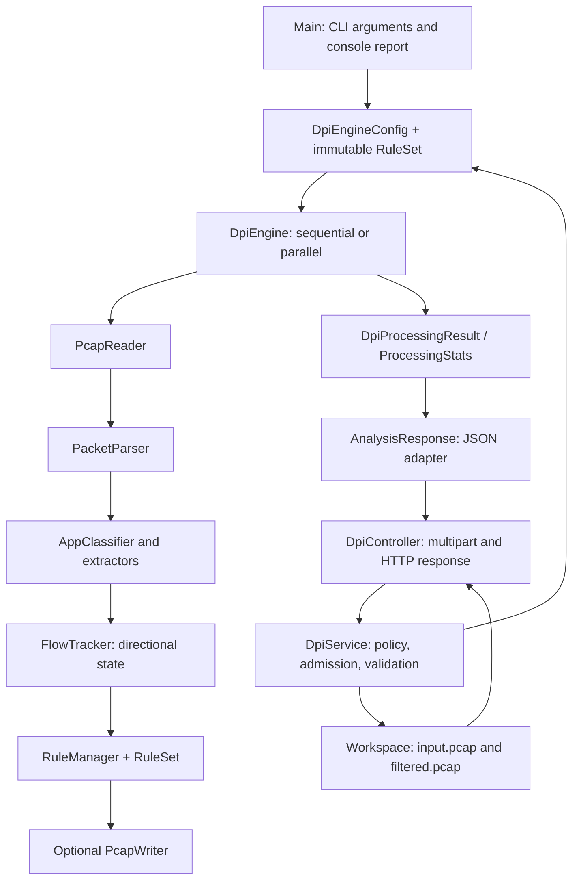
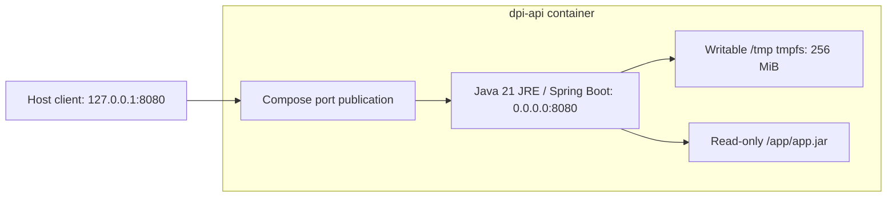

# Architecture

[Project overview](../README.md) · [Data flow](DATA_FLOW.md) · [Sequences](SEQUENCE.md) · [Technical details](TECHNICAL.md)

## Modules and responsibilities

The root [pom.xml](../pom.xml) aggregates two modules, rather than supplying their parent configuration. [dpi-engine-java](../dpi-engine-java/pom.xml) is the Java 21 core and CLI, using the standard library at runtime. [dpi-engine-api](../dpi-engine-api/pom.xml) has the Spring Boot parent and depends on the core artifact. The core has no web dependency. 

Arrows show component dependencies or processing handoffs; the [DFDs](DATA_FLOW.md) distinguish the data carried between them.

## Core pipeline

`DpiEngine.process` creates fresh parser, classifier, flow and rule state on every call. It reads the global header and validates a requested output path before opening a new writer. For every complete record it checks budgets, parses supported packets, inspects payloads, updates flow state, evaluates rules, updates counts, and optionally writes allowed records. Unparseable network packets bypass flow tracking and rules and are allowed. A successful result is returned after input and output close successfully. An I/O failure returns an exception containing partial statistics, not a successful result.

Flow keys include source/destination IPv4 strings, source/destination ports and protocol, without endpoint sorting. Reverse traffic is separate. Flow state retains packet/captured-byte counts, minimum/maximum capture timestamps, observation status, hostname and application. The first specific application wins; generic states can be upgraded. Final application distribution counts flows, including blocked flows, rather than packets.

`RuleSet` collects every applicable exact-IP, application and domain-root reason. Any match blocks; there are no allow rules that override a block. `RuleManager` caches the first block for each directional key. Allowed flows are re-evaluated on subsequent packets, so later classification can block them; earlier output is never revisited. [TECHNICAL.md](TECHNICAL.md) explains classification selection and reason order.

## Sequential and parallel execution

One thread uses the direct pipeline. More than one selects `ParallelDpiEngine`. Its coordinator performs reading, parsing and global record/flow admission, then hashes the full directional key to a worker. Each worker owns a classifier, tracker, rule manager and single-thread FIFO executor. Unsupported packets use sequence-based round-robin dispatch.

The coordinator assigns increasing sequence numbers and consumes futures in submission order. Only it writes output and aggregates packet decisions. A global pending window bounds queued, active and completed-but-unwritten packets together; reaching it pauses reading. The core default window is 64 and configurable in 1–4096; the API supplies 8. Workers also have bounded queues. Flow snapshots are merged after workers terminate.

Successful sequential/parallel runs preserve the same retained-record order and bytes and the same statistics except duration. Map serialization order is not promised. A slow early packet can delay writes; a single busy flow stays on one worker. Reading, parsing and writing remain serialized. No speedup is asserted without measurements.

Normal EOF drains submitted work and joins executors. Truncated input drains complete submitted records before failing. Worker/write failures cancel work. Shutdown uses a shared 30-second wait followed by forced shutdown and a second shared 30-second wait; interruption is restored, and secondary shutdown failures are suppressed onto an existing failure. Java cannot forcibly stop uncooperative worker code.

## API boundary and ownership

Spring binds multipart parts and validates the optional options DTO before calling the service. The service checks empty/oversized uploads, builds rules, checks worker policy and immediately tries request and combined worker permits. Busy admission returns 429 with no application processing queue. Basic upload/options checks precede admission; servlet multipart spooling also occurs before admission.

Once admitted, the service creates a unique `request-*` workspace and transfers the upload to `input.pcap`. A first reader validates the full classic-PCAP framing and record-byte/count budgets, rejecting non-Ethernet link types before processing. The core then opens the input again with record/flow/byte budgets. This costs an extra read but prevents a malformed trailing record from being discovered after download generation starts.

Analyze uses a null output path, maps statistics to `AnalysisResponse`, closes the workspace and releases permits before the controller returns JSON. Filter generates and closes `filtered.pcap` completely, then invokes the controller's synchronous download callback. Headers are set only then; `Files.copy` transfers the file without materializing a full download byte array. The workspace and permits stay owned until the callback completes or fails. Thus deletion is deliberately deferred until copying ends, not scheduled in an asynchronous cleanup task.

Cleanup attempts output, input and directory deletion even if one fails. Try-with-resources preserves a primary failure and suppresses cleanup failures; a cleanup failure alone becomes an I/O failure. Before response commitment the controller resets download headers so error advice can return a problem. After commitment it cannot replace the status/body. There is no janitor or crash recovery. See [API limits](API.md) and [request sequences](SEQUENCE.md).

## Docker runtime

The build stage runs both modules' tests with Maven and copies only the executable API JAR into the runtime stage. Runtime UID/GID is 10001. Compose sets a read-only filesystem, writable `/tmp`, 1 GiB memory, two CPUs, 256 PIDs, dropped capabilities and no new privileges. JVM heap is capped at 512 MiB. There is no database, persistent volume or external classification service. [DOCKER.md](../DOCKER.md) is the deployment reference.

## Decisions and tradeoffs

| Decision | Benefit and cost |
| --- | --- |
| Separate CLI-independent core | Reusable through both adapters; adapters must apply their own policies |
| Packet-local inspection | Simple bounded parsing; split/encrypted payloads lose visibility |
| Directional state and flow affinity | No shared mutable flow tables; no reverse-direction classification inheritance |
| Sticky blocking | Stable subsequent decisions; no retroactive removal or reason refresh after first block |
| Ordered bounded futures | Deterministic output and backpressure; head-of-line waiting |
| Retain all admitted flows | Complete final report; memory grows with flow count |
| Two-pass API validation | Clear framing failures before output generation; extra I/O |
| Synchronous download ownership | Reliable normal cleanup; slow clients occupy request/worker permits |
| Explicit workload budgets | Predictable rejection; not an exact heap or global disk quota |
