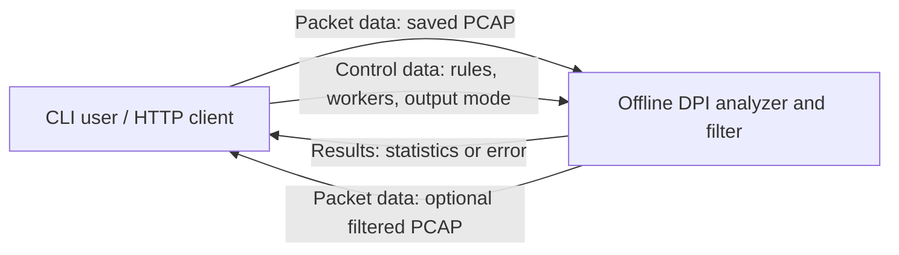
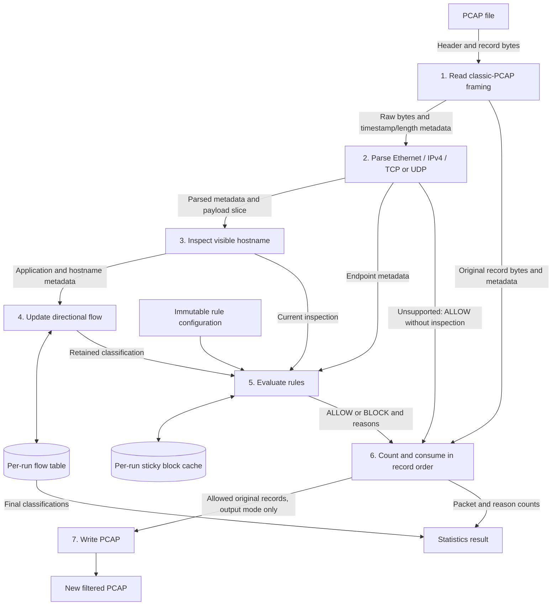
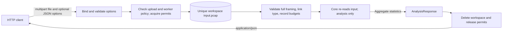
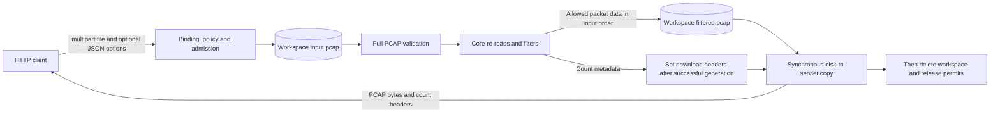

# Data flow

[Overview](../README.md) · [Architecture](ARCHITECTURE.md) · [Sequences](SEQUENCE.md)

These DFDs describe saved capture processing. Packet bytes stay associated with their capture metadata; rules and classification metadata do not rewrite packet contents. Stores below are local files or per-run memory, not databases.

## Level 0: context

CLI results include flow examples; API analysis exposes aggregate statistics only. Filter sends a PCAP with count headers rather than an analysis JSON body.

## Level 1: processing

The original record accompanies each decision until ordered consumption. In parallel mode the read/parse stages and output are coordinated serially; inspection, tracking and rules run on flow-affine workers with independent stores. The pending window bounds packet references across all workers. Unsupported network records create no flow entries. Malformed PCAP framing causes an error instead of a successful result.

## Analyze data flow

This diagram represents the successful path. File validation reads the stored input; the core independently reopens it. No output PCAP is created. Failures use cleanup when a workspace exists and then error translation; admission rejection creates no workspace.

## Filter data flow

Filter is streamed from a completed disk file, not produced directly into the HTTP connection. A client disconnect still triggers cleanup attempts. A failure after response commitment may leave a partial download and cannot become a new JSON response.

## Data inventory

| Data | Source / store | Output / lifetime |
| --- | --- | --- |
| Capture bytes | CLI file or servlet multipart upload, then API `input.pcap` | Read-only input to processing; API copy deleted on workspace close |
| Capture metadata | PCAP global header, timestamps, captured/original lengths | Preserved for retained output records |
| Parsed metadata | PacketParser endpoint, transport and payload-offset fields | Used for tracking/inspection; no independent persistent store |
| Rules | CLI flags or options arrays, normalized immutable RuleSet | Per-run evaluation; no rule database |
| Flow metadata | Per-run FlowTracker map | Final flow snapshots/core report; only aggregates in API JSON |
| Block decisions | Per-run RuleManager map | First block and its reasons retained until run ends |
| Pending records | Bounded futures in parallel coordinator | Released after ordered consumption; no disk queue |
| Filtered capture | New CLI path or API `filtered.pcap` | CLI file persists; API file deleted after transfer attempt |
| Results | ProcessingStats / AnalysisResponse | CLI console, analyze JSON, or filter count headers |

Servlet multipart temporary storage is managed by the web framework and is separate from the explicit request workspace. Multipart limits apply before service admission and do not impose a global disk quota.
