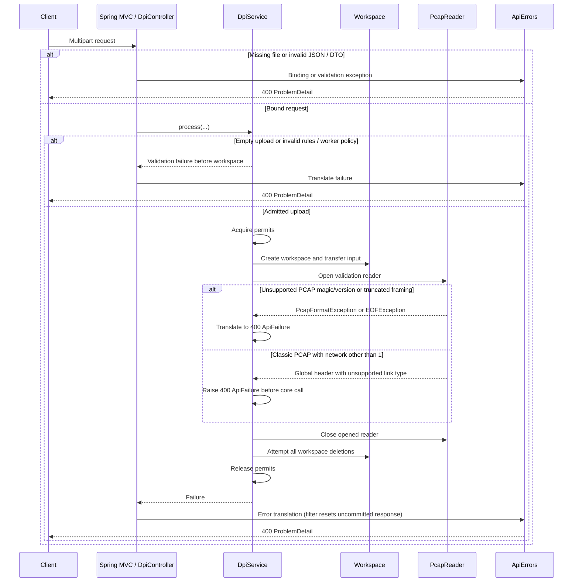

# Request sequences

[API reference](API.md) · [Architecture](ARCHITECTURE.md) · [Data flow](DATA_FLOW.md)

The diagrams use actual controller/service boundaries. Spring performs multipart binding and Bean Validation before the service. Basic upload/rule/worker policy checks precede permit acquisition. Admission failures return 429 immediately; no workspace is created. Servlet multipart spooling can already have occurred.

## POST /api/v1/dpi/analyze: success

```mermaid
sequenceDiagram
    participant C as Client
    participant W as Spring MVC / DpiController
    participant S as DpiService
    participant T as Workspace
    participant R as PcapReader
    participant E as DpiEngine
    C->>W: POST multipart file + optional JSON options
    W->>W: Bind parts and validate DTO
    W->>S: process(file, options, null)
    S->>S: Check upload, rules and worker policy
    S->>S: Acquire request and worker permits
    S->>T: Create request directory; transfer input.pcap
    S->>R: Open input with record-byte limit
    R-->>S: Global header
    S->>S: Require Ethernet link type 1
    loop Complete PCAP records
        S->>R: Read and validate framing; check record count
        R-->>S: Record
    end
    S->>R: Close validation reader
    S->>E: Process input, null output, rules and budgets
    E->>E: Read again; parse, classify, track and evaluate
    E->>E: Close I/O and join workers if parallel
    E-->>S: DpiProcessingResult
    S->>S: Map ProcessingStats to AnalysisResponse
    S->>T: Close: delete output if present, input, directory
    S->>S: Release worker and request permits
    S-->>W: AnalysisResponse
    W-->>C: 200 application/json
```

`writtenPackets` is zero in analysis mode. Engine duration covers the core call, not the service's validation pass, upload transfer, JSON serialization or download time.

## POST /api/v1/dpi/filter: success and transfer failure

```mermaid
sequenceDiagram
    participant C as Client
    participant W as Spring MVC / DpiController
    participant S as DpiService
    participant T as Workspace
    participant E as DpiEngine
    C->>W: POST multipart file + optional JSON options
    W->>W: Bind and validate DTO
    W->>S: process(file, options, download callback)
    S->>S: Check policy; acquire request and worker permits
    S->>T: Create workspace; store input.pcap
    S->>S: Validate entire input with PcapReader; require Ethernet
    S->>E: Process with output path and budgets
    E->>T: Write allowed records to filtered.pcap
    E->>E: Close writer/reader; join parallel workers
    E-->>S: Successful result
    S->>W: Invoke callback(output path, statistics)
    W->>W: Set PCAP type, attachment, count headers and Content-Length
    Note over S,T: Workspace and permits remain owned during copying
    alt Copy succeeds
        W->>C: Files.copy to servlet stream
        W-->>S: Callback completes
    else Client disconnect or disk read failure
        W->>C: Partial transfer may already be committed
        W-->>S: Callback throws IOException
    end
    S->>T: Attempt output, input and directory deletion
    S->>S: Release worker and request permits
    alt No processing, transfer or cleanup failure
        S-->>W: Return statistics (not serialized by filter)
        W-->>C: Finish 200 PCAP response
    else Failure propagates
        S-->>W: Exception, with secondary cleanup errors suppressed
        alt Response not committed
            W->>W: Reset download headers
            W-->>C: Error advice returns JSON problem
        else Response committed
            Note over W,C: Existing status/body cannot be replaced by JSON
        end
    end
```

Cleanup is deferred **until synchronous copying finishes**, not until an asynchronous callback or a background janitor runs. Filesystem refusal may leave files; process termination can bypass cleanup. No persistent retry mechanism exists. A cleanup-only failure propagates as an I/O failure too.

## Invalid upload and unsupported link type: both endpoints



The final diagram focuses on 400 paths. Upload or processing budgets produce 413, wrong request/options media types produce 415, busy permits produce 429, and genuine storage/processing I/O produces 500. Those paths follow the same ownership rules for whatever resources were already acquired. An unsupported network packet within Ethernet PCAP is allowed/skipped rather than triggering the link-type error.
